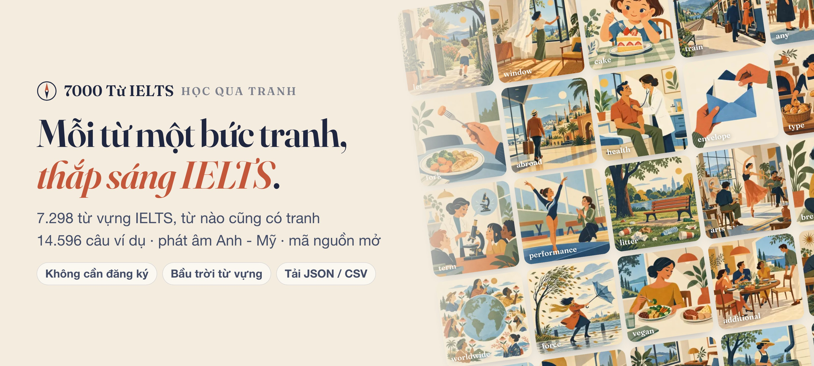
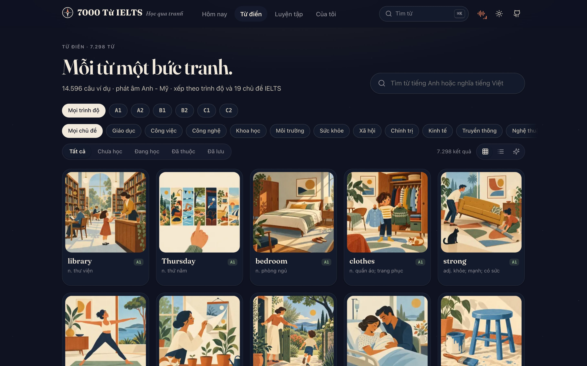
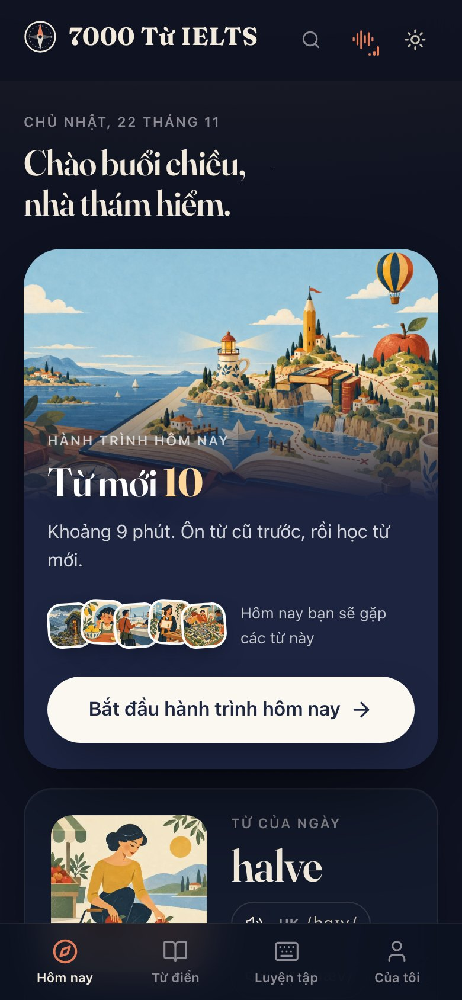
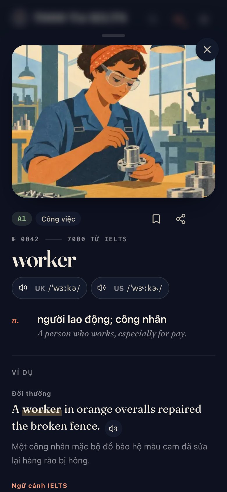
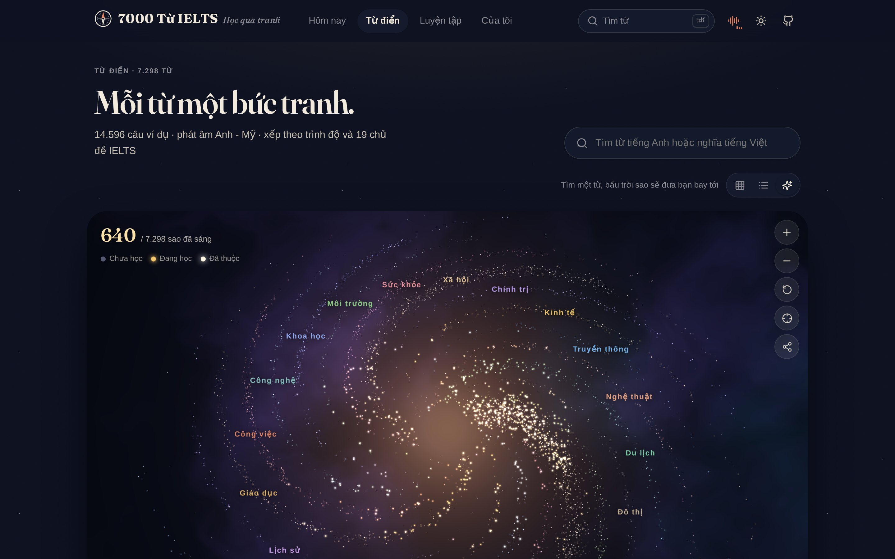

<div align="center">



# 7000 Từ IELTS · Học qua tranh

**Mỗi từ một bức tranh, thắp sáng IELTS**

7,298 IELTS entries · Original illustrations · UK & US audio · Spaced repetition

[**Download the dataset**](data/) / [Tiếng Việt](README.md)

[](LICENSE)
[](CONTENT_LICENSE.md)

</div>

---

7000 Từ IELTS ("7,000 IELTS words") is an illustrated vocabulary app for Vietnamese-speaking IELTS learners. Connect words with scenes and pronunciation, practise active recall, and return to them with FSRS spaced repetition. No account required. Learning progress stays on your device.

> **Edition note:** This repository is the Vietnamese edition, adapted from the open-source [Word Atlas](https://github.com/designfuchen/word-atlas) project by [designfuchen](https://github.com/designfuchen). English content, illustrations and recordings are reused from the original project. The Vietnamese meanings, example translations, tips and interface were rewritten for Vietnamese learners. The code and dataset remain available under the MIT and CC BY 4.0 licenses described below.

[Preview](#preview) · [Learning loop](#learning-loop) · [Quick start](#quick-start) · [Open dataset](#open-dataset) · [Contributing](#contributing)

## Preview

### A picture dictionary you can listen to and practise with



<table>
<tr>
<td width="50%"></td>
<td width="50%"></td>
</tr>
<tr><td align="center">A plan for today</td><td align="center">A scene for every word</td></tr>
</table>

<sub>Actual screenshots of the Vietnamese edition, regenerated with <code>node scripts/render-cards.mjs --app &lt;url&gt;</code>. The header banner is rendered from the dataset itself.</sub>

### Words you learn become your own star map



Explore 19 topic groups, rotate and zoom the galaxy, and select a star to open its word card. Brightness reflects learning status. Built with WebGL2, with a simpler fallback for unsupported devices.

## Learning loop

| Step | What you do |
| :--- | :--- |
| **See** | Explore an illustration, Vietnamese and English definitions, two original examples with Vietnamese translations, collocations, word families and usage tips. |
| **Hear** | Switch between UK English (Anh - Anh) and US English (Anh - Mỹ) and listen to example sentences. A subset includes audio for the second example. |
| **Recall** | Practise choosing the meaning of a word, filling in a word from a picture and sentence, listening recognition and spelling. |
| **Review** | Let FSRS schedule reviews based on your history. The target recall rate can be adjusted. Only the first answer counts toward accuracy. |
| **Keep** | Track progress in the galaxy, practise typing separately, and export or restore your local progress. |

**Local first.** Visited entries and media can be cached for offline use. Export a progress backup before moving to another device.

Listen to a sample: **abandon**: [UK](public/atlas/audio/uk/abandon.mp3) · [US](public/atlas/audio/us/abandon.mp3) · [Example](public/atlas/audio/ex/abandon.mp3).

Voice and ambience files are in `public/sfx/`: the splash voice line "Chào mừng bạn mở cánh cửa IELTS" (Welcome, open the door to IELTS), the galaxy greeting "Đây là bầu trời từ vựng của bạn. Thuộc một từ, sáng thêm một ngôi sao." (This is your vocabulary sky. Learn a word, light up a star.), and seven looping ambience tracks: Nhạc trời sao (starry music), Thư viện ngày mưa (rainy library), Bờ biển sớm mai (morning shore), Buổi sáng trong rừng (forest morning), Lò sưởi đêm khuya (late-night fireplace), Khoang tàu viễn dương (ocean voyage cabin) and Quán cà phê yên tĩnh (quiet café).

## Quick start

Requires **Node.js 20+** and npm. This repository includes the full image and audio collection, so the initial download can take time.

```bash
git clone --depth 1 https://github.com/thuongtin/word-atlas.git
cd word-atlas
npm ci
npm run dev
```

Open **http://localhost:5188**.

```bash
npm test             # Unit tests
npm run check:atlas  # Dataset and media validation
npm run build        # Production build in dist/
```

For a subpath deployment: `ATLAS_BASE=/words/ npm run build`. See the [deployment guide](docs/deployment.md).

A Full HD intro video for the app (Remotion, with a synthesized soundtrack) lives in [`video/`](video/README.md).

**Stack:** React 19 · TypeScript · Vite · ts-fsrs · WebGL2

## Open dataset

Use the app as it is, or build your own learning tools, Anki decks and research projects.

| Resource | Vietnamese edition | Download / documentation |
| :--- | :--- | :--- |
| Entries | **7,298**, CEFR A1-C2, 19 topics | [JSON](data/word-atlas.json) · [CSV](data/word-atlas.csv) |
| Examples | **14,596**, everyday and IELTS contexts, with Vietnamese translations | [Schema](docs/dataset.md) |
| Illustrations | **7,298**, 512 px WebP plus thumbnails | [Images](public/atlas/img/) |
| Recordings | **22,905**, UK English and US English words plus example sentences | [Audio](public/atlas/audio/) |

```python
import json
from pathlib import Path

words = json.loads(Path("data/word-atlas.json").read_text(encoding="utf-8"))
b2_environment = [w for w in words if w["cefr"] == "B2" and w["topic"] == "environment"]
```

<details>
<summary><b>View the data structure of one entry</b></summary>

```json
{
  "id": "principle",
  "w": "principle",
  "uk": "/ˈprɪnsəpəl/",
  "us": "/ˈprɪnsəpəl/",
  "senses": [
    { "pos": "n.", "vi": "nguyên tắc; chuẩn mực ứng xử", "en": "A belief or rule that guides decisions and behaviour." },
    { "pos": "n.", "vi": "nguyên lý; quy luật cơ bản", "en": "A basic truth explaining how something works." }
  ],
  "ex": [
    { "en": "I refused the extra money as a matter of principle.", "vi": "Tôi từ chối khoản tiền được đưa thêm vì nguyên tắc của mình." },
    { "en": "The principle of equal opportunity should guide policies designed to improve access to higher education.", "vi": "Các chính sách nhằm mở rộng cơ hội tiếp cận giáo dục đại học cần dựa trên nguyên tắc bình đẳng về cơ hội." }
  ],
  "col": ["basic principle|nguyên tắc cơ bản; nguyên lý cơ bản", "in principle|về nguyên tắc"],
  "fam": ["principled (adj.)", "unprincipled (adj.)"],
  "syn": ["rule", "standard", "doctrine"],
  "tip": "\"Principle\" có nghĩa là nguyên tắc hoặc nguyên lý, còn \"principal\" phát âm giống hệt nhưng có thể nghĩa là chính hoặc hiệu trưởng.",
  "cefr": "B2",
  "topic": "thinking"
}
```

</details>

### Provenance and limitations

English text and illustrations were generated with AI, and voices were produced with ElevenLabs, by the original Word Atlas project. The Vietnamese text was written by a large language model from the English content. Everything passed automatic structure and consistency checks, but **the entire collection has not been reviewed entry by entry by humans**. Meanings, examples, illustrations or pronunciation may contain errors. This is not an official IELTS word list and does not promise score improvements.

[Generation pipeline](docs/pipeline.md) · [Learning model](docs/learning-model.md) · [Scripts](scripts/atlas/)

## Contributing

Please include the **word ID, reproduction steps and expected result** when reporting a problem. For vocabulary corrections, reliable dictionary references are welcome.

- [Report an issue](https://github.com/thuongtin/word-atlas/issues/new/choose)
- [Contribution guide](CONTRIBUTING.md)
- [Security policy](SECURITY.md)

## License

| Scope | License |
| :--- | :--- |
| Application code | [MIT](LICENSE) |
| Vocabulary text, illustrations and word recordings | [CC BY 4.0](CONTENT_LICENSE.md), credit "Word Atlas contributors". The Vietnamese text is an adaptation released under the same CC BY 4.0. |
| Dependencies and fonts | Their respective licenses |

---

Based on Word Atlas by [@designfuchen](https://github.com/designfuchen). The Vietnamese edition is maintained at https://github.com/thuongtin/word-atlas.

If 7000 Từ IELTS helps you, consider starring the repository or sharing it with friends who are learning English.
