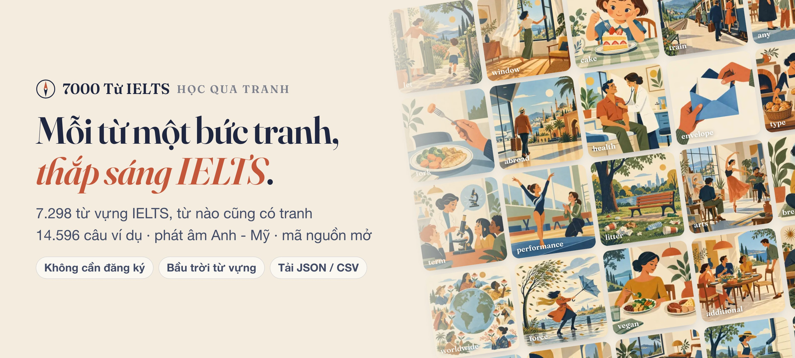
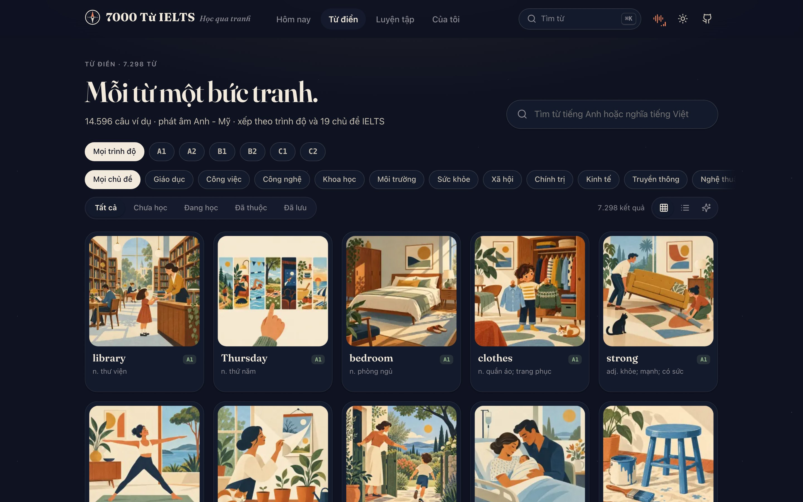
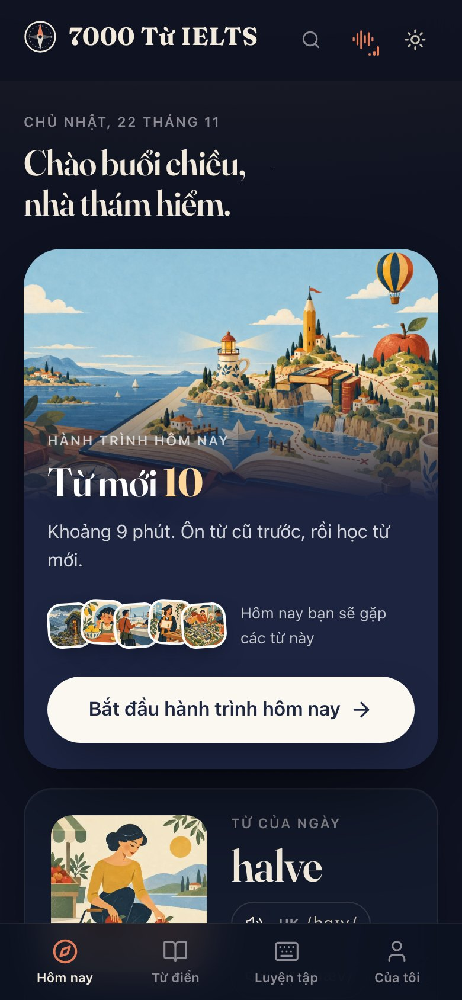
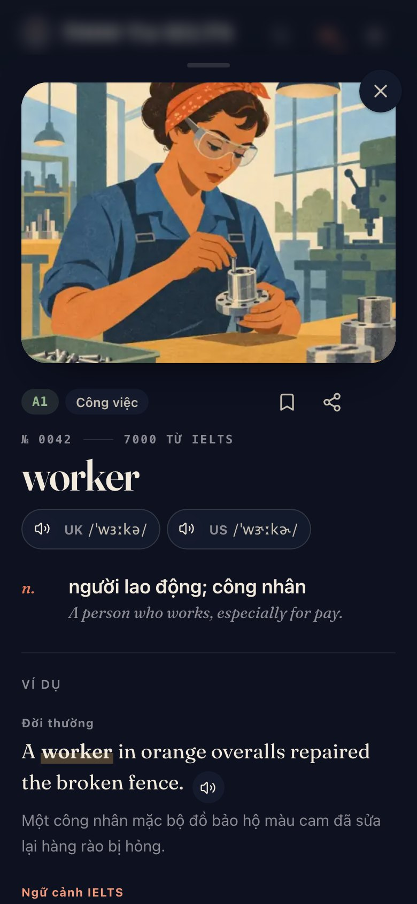
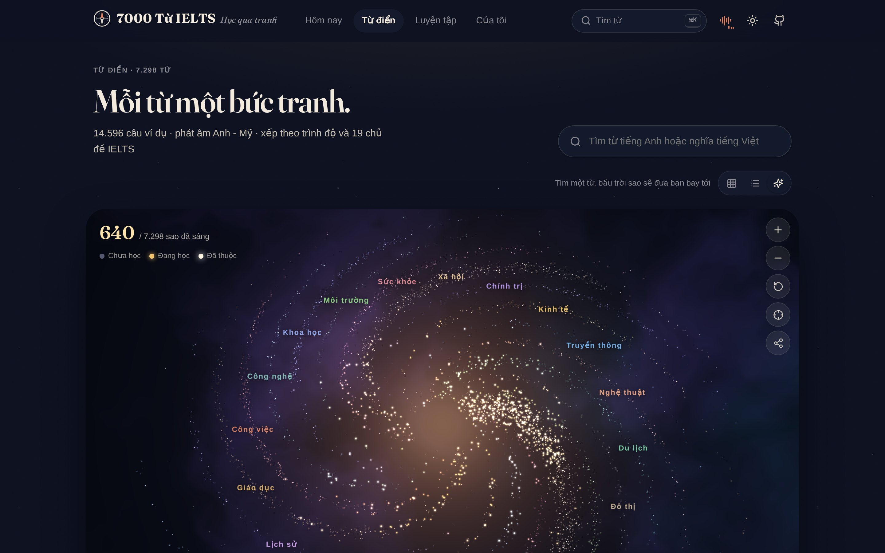

<div align="center">



# 7000 Từ IELTS · Học qua tranh

**Mỗi từ một bức tranh, thắp sáng IELTS**

7.298 mục từ IELTS · Tranh minh họa gốc · Giọng Anh - Anh và Anh - Mỹ · Ôn tập ngắt quãng FSRS

[**Tải bộ từ**](data/) / [English](README.en.md)

[](LICENSE)
[](CONTENT_LICENSE.md)

</div>

---

7000 Từ IELTS là ứng dụng học từ vựng bằng tranh minh họa, dành cho người Việt luyện thi IELTS. Ứng dụng kết nối từ với khung cảnh và cách phát âm, luyện chủ động nhớ lại, và dùng thuật toán FSRS để ôn tập ngắt quãng. Không cần tài khoản. Tiến độ học được lưu trên chính thiết bị của bạn.

> **Ghi chú phiên bản:** Kho này là bản tiếng Việt, được chuyển thể từ dự án mã nguồn mở [Word Atlas](https://github.com/designfuchen/word-atlas) của designfuchen. Nội dung tiếng Anh, tranh minh họa và bản ghi âm được giữ lại từ dự án gốc. Nghĩa tiếng Việt, bản dịch câu ví dụ, mẹo học và giao diện được viết lại cho người học Việt Nam. Mã nguồn và dữ liệu tuân theo giấy phép MIT và CC BY 4.0 như mô tả bên dưới.

[Xem trước](#xem-trước-sản-phẩm) · [Cách học](#cách-học) · [Chạy cục bộ](#chạy-ở-máy-cục-bộ) · [Dữ liệu mở](#dữ-liệu-mở) · [Đóng góp](#đóng-góp)

## Xem trước sản phẩm

### Một bộ từ điển tranh để nghe và luyện tập



<table>
<tr>
<td width="50%"></td>
<td width="50%"></td>
</tr>
<tr><td align="center">Kế hoạch học trong ngày</td><td align="center">Mỗi từ một khung cảnh</td></tr>
</table>

<sub>Ảnh chụp thực tế của bản mã nguồn mở. Ảnh đầu trang là tranh concept của thương hiệu.</sub>

### Những từ đã học hợp thành bầu trời sao của riêng bạn



19 nhóm chủ đề tạo thành bầu trời từ vựng. Kéo để xoay, cuộn để phóng to, chạm vào ngôi sao để mở thẻ từ. Độ sáng của mỗi ngôi sao cho biết trạng thái học. Bầu trời được vẽ bằng WebGL2, thiết bị không hỗ trợ sẽ được hiển thị ở chế độ đơn giản hơn.

## Cách học

| Bước | Bạn làm gì |
| :--- | :--- |
| **Thấy** | Xem tranh minh họa, nghĩa tiếng Việt và tiếng Anh, hai câu ví dụ gốc kèm bản dịch, cùng cụm từ thường gặp, họ từ và mẹo dùng. |
| **Nghe** | Chuyển giữa giọng Anh - Anh và Anh - Mỹ, nghe câu ví dụ được đọc to. Một số mục có thêm bản ghi âm cho câu ví dụ thứ hai. |
| **Nhớ lại** | Chọn nghĩa đúng theo từ, chọn từ điền vào câu theo tranh, nghe để nhận ra từ, và luyện đánh vần. |
| **Ôn tập** | FSRS xếp lịch ôn dựa trên lịch sử học của bạn. Tỉ lệ ghi nhớ mục tiêu có thể điều chỉnh. Chỉ lần trả lời đầu tiên được tính vào độ chính xác. |
| **Tích lũy** | Tiến độ hiển thị trên bầu trời sao. Luyện gõ được thống kê riêng. Có thể xuất và khôi phục tiến độ lưu cục bộ. |

**Ưu tiên lưu cục bộ.** Không cần đăng ký. Các mục đã xem và tệp media có thể lưu đệm để dùng khi ngoại tuyến. Trước khi chuyển sang thiết bị khác, hãy xuất bản sao lưu tiến độ.

<details>
<summary><b>Nghe phát âm, câu ví dụ và âm thanh môi trường</b></summary>

Lấy *abandon* làm ví dụ, nhấn vào liên kết để nghe:

| | |
|---|---|
| 🇬🇧 Anh - Anh | [abandon /əˈbændən/](public/atlas/audio/uk/abandon.mp3) |
| 🇺🇸 Anh - Mỹ | [abandon /əˈbændən/](public/atlas/audio/us/abandon.mp3) |
| 📖 Đọc câu ví dụ | [We had to abandon our car in the snow.](public/atlas/audio/ex/abandon.mp3) |

Toàn bộ 7.298 mục đều có giọng Anh - Anh, Anh - Mỹ và đọc câu ví dụ. Riêng 1.011 mục trọng điểm có thêm bản đọc cho câu ví dụ thứ hai.

### Âm thanh môi trường và âm thanh tương tác

| | |
| :--- | :--- |
| 🎙 **Lời chào mở đầu** | [“Chào mừng bạn mở cánh cửa IELTS”](public/sfx/splash-voice.mp3): bụi sao tụ lại thành chiếc la bàn, tên ứng dụng hiện lên, cánh cửa mở ra |
| 🌌 **Lời chào bầu trời** | [“Đây là bầu trời từ vựng của bạn. Thuộc một từ, sáng thêm một ngôi sao.”](public/sfx/voice-galaxy-hello.mp3) |
| 🎵 **Nhạc trời sao** | [Nhạc nền nguyên bản, lặp liền mạch](public/sfx/amb-stars.mp3), mặc định phát khi bạn học |
| 🌧 **6 âm thanh môi trường** | [Thư viện ngày mưa](public/sfx/amb-rain.mp3) · [Bờ biển sớm mai](public/sfx/amb-sea.mp3) · [Buổi sáng trong rừng](public/sfx/amb-forest.mp3) · [Lò sưởi đêm khuya](public/sfx/amb-fire.mp3) · [Khoang tàu viễn dương](public/sfx/amb-voyage.mp3) · [Quán cà phê yên tĩnh](public/sfx/amb-cafe.mp3) |
| ✨ **Âm thanh giao diện** | Đúng, sai, lật thẻ, gõ phím, chuỗi thắng, thắp sáng sao... mỗi thao tác có một âm riêng. Khi đọc từ, nhạc nền tự nhỏ lại. |

Toàn bộ tài nguyên nằm trong kho: tranh ở `public/atlas/img/`, bản ghi âm ở `public/atlas/audio/`. Hai nhóm này được mở theo CC BY 4.0. Âm thanh giao diện và nhạc nền nằm ở `public/sfx/`, đi kèm ứng dụng.

</details>

## Chạy ở máy cục bộ

Cần **Node.js 20+** và npm. Kho có đầy đủ ảnh và bản ghi âm nên lần tải đầu có thể mất một lúc.

```bash
git clone --depth 1 https://github.com/thuongtin/word-atlas.git
cd word-atlas
npm ci
npm run dev
```

Mở **http://localhost:5188**.

```bash
npm test             # Kiểm thử đơn vị
npm run check:atlas  # Kiểm tra cấu trúc bộ từ và media
npm run build        # Build vào thư mục dist/
```

Triển khai dưới đường dẫn con: `ATLAS_BASE=/words/ npm run build`. Xem chi tiết trong [tài liệu triển khai](docs/deployment.md).

**Công nghệ:** React 19 · TypeScript · Vite · ts-fsrs · WebGL2

## Dữ liệu mở

Bạn có thể dùng ứng dụng như hiện tại, hoặc dùng bộ từ cho công cụ học riêng, bộ thẻ Anki hay dự án nghiên cứu.

| Tài nguyên | Nội dung bản mã nguồn mở | Tải về / tài liệu |
| :--- | :--- | :--- |
| Mục từ | **7.298** mục, CEFR A1-C2, 19 chủ đề | [JSON](data/word-atlas.json) · [CSV](data/word-atlas.csv) |
| Câu ví dụ | **14.596** câu, ngữ cảnh đời sống và IELTS, kèm bản dịch tiếng Việt | [Cấu trúc dữ liệu](docs/dataset.md) |
| Tranh minh họa | **7.298** tranh, WebP 512 px, kèm ảnh thu nhỏ | [Thư mục ảnh](public/atlas/img/) |
| Bản ghi âm | **22.905** đoạn, giọng Anh - Anh, Anh - Mỹ và đọc câu ví dụ | [Thư mục âm thanh](public/atlas/audio/) |

```python
import json
from pathlib import Path

words = json.loads(Path("data/word-atlas.json").read_text(encoding="utf-8"))
b2_environment = [w for w in words if w["cefr"] == "B2" and w["topic"] == "environment"]
```

<details>
<summary><b>Xem cấu trúc dữ liệu của một mục từ</b></summary>

```json
{
  "id": "principle",
  "w": "principle",
  "uk": "/ˈprɪnsəpəl/",
  "us": "/ˈprɪnsəpəl/",
  "senses": [{ "pos": "n.", "vi": "nguyên tắc; chuẩn mực hành xử", "en": "A belief or rule that guides decisions and behaviour." }],
  "ex": [
    { "en": "I refused the extra money as a matter of principle.", "vi": "Tôi từ chối khoản tiền thêm đó vì nguyên tắc." },
    { "en": "The principle of equal opportunity should guide policies designed to improve access to higher education.", "vi": "Nguyên tắc cơ hội bình đẳng cần định hướng các chính sách nhằm mở rộng khả năng tiếp cận giáo dục đại học." }
  ],
  "col": ["in principle|về nguyên tắc", "basic principle|nguyên tắc cơ bản"],
  "fam": ["principled (adj.)"],
  "tip": "principle là nguyên tắc; principal là hiệu trưởng hoặc chính, chủ yếu.",
  "cefr": "B2",
  "topic": "thinking"
}
```

</details>

### Nguồn nội dung và giới hạn

Nghĩa, câu ví dụ, tranh minh họa và bản ghi âm tiếng Anh do dự án Word Atlas gốc tạo ra: văn bản và tranh bằng AI tạo sinh, giọng đọc bằng ElevenLabs. Phần tiếng Việt do một mô hình ngôn ngữ lớn viết từ nội dung tiếng Anh. Nội dung đã qua kiểm tra cấu trúc và tính nhất quán tự động, nhưng **chưa được con người duyệt từng mục**. Có thể còn lỗi về nghĩa, câu ví dụ, tranh minh họa hoặc phát âm. Đây không phải danh sách từ chính thức của IELTS và không cam kết giúp tăng điểm.

[Quy trình tạo nội dung](docs/pipeline.md) · [Mô hình ghi nhớ](docs/learning-model.md) · [Script tạo dữ liệu](scripts/atlas/)

## Đóng góp

Khi báo lỗi, hãy kèm **mã mục từ, các bước tái hiện và kết quả mong đợi**. Với đề xuất sửa nội dung, tham chiếu từ điển đáng tin cậy sẽ giúp kiểm tra nhanh hơn.

- [Báo lỗi](https://github.com/thuongtin/word-atlas/issues/new/choose): sửa mục từ, lỗi giao diện hoặc góp ý khi sử dụng.
- [Hướng dẫn đóng góp](CONTRIBUTING.md): đồng bộ dữ liệu, quy chuẩn mã nguồn và kiểm tra trước khi gửi.
- [Chính sách bảo mật](SECURITY.md): cách báo cáo vấn đề bảo mật.

## Giấy phép

| Phạm vi | Giấy phép |
| :--- | :--- |
| Mã nguồn ứng dụng | [MIT](LICENSE) |
| Văn bản, tranh minh họa và bản ghi âm của mục từ | [CC BY 4.0](CONTENT_LICENSE.md), ghi công "Word Atlas contributors". Phần văn bản tiếng Việt là bản chuyển thể, được phát hành theo cùng giấy phép CC BY 4.0. |
| Thư viện bên thứ ba và phông chữ | Theo giấy phép của từng bên, xem tệp tương ứng |

---

Dựa trên Word Atlas của [@designfuchen](https://github.com/designfuchen). Bản tiếng Việt được duy trì tại https://github.com/thuongtin/word-atlas.

Nếu 7000 Từ IELTS hữu ích với bạn, hãy tặng một Star hoặc chia sẻ cho bạn bè đang học tiếng Anh.
